<div align="center">

# 👑 HalfACiv

### Da primeira fogueira a um reino: um idle medieval inteiramente no terminal.


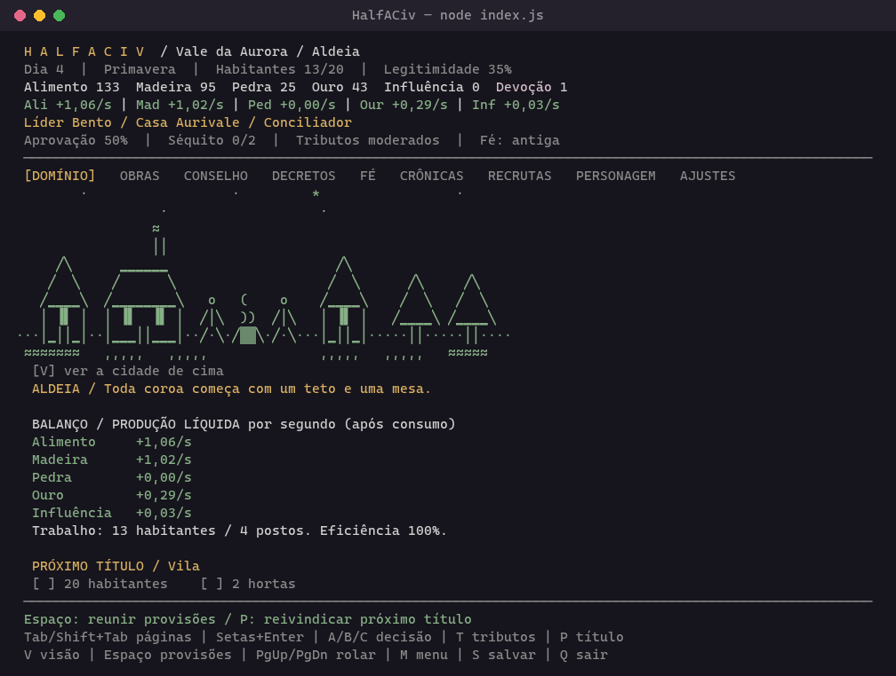

*Doze famílias chegam ao Vale da Aurora. Alimente a aldeia, erga uma cidade e reúna apoio suficiente para fundar um reino.*

</div>

---

## Sumário

- [Início rápido](#-início-rápido)
- [Capturas](#-capturas)
- [Controles](#-controles)
- [Como o vale cresce](#-como-o-vale-cresce)
- [Obras especiais e planta da cidade](#-obras-especiais-e-planta-da-cidade)
- [Recrutas e governante](#-recrutas-e-governante)
- [Saves e progresso offline](#-saves-e-progresso-offline)
- [Desenvolvimento](#-desenvolvimento)
- [Referência e identidade](#-referência-e-identidade)

---

## 🚀 Início rápido

Requer **Node.js 18 ou superior**. Não há dependências para instalar.

```sh
git clone https://github.com/cloudhadock-coder/Half-A-Civ.git
cd Half-A-Civ
npm start
```

No Windows, também é possível abrir `Jogar.cmd` com dois cliques.

> [!TIP]
> Use Windows Terminal ou PowerShell com pelo menos **80×24**. Em **110×36**, as artes e os detalhes ficam melhores.

Na primeira vez, sem save, um **prólogo em três atos** apresenta a queda do antigo reino, a chegada das famílias e o peso da futura coroa, com cenas ASCII e texto revelado aos poucos. `Enter` revela o texto e depois avança; `Esc` pula para o menu.

<div align="center">
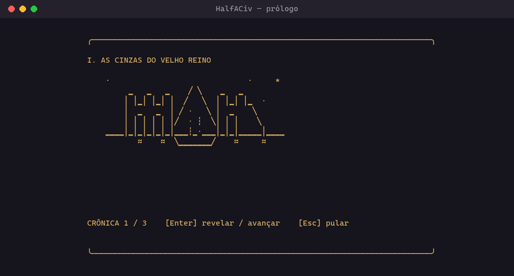
</div>

Com um save, o jogo abre direto no menu: **Continuar domínio**, **Fundar novo domínio**, **Rever o prólogo**, **Como governar** e **Sair**. Ao fundar, você escolhe o nome da cidade. Substituir uma campanha exige confirmação e guarda o save anterior em `saves/realm.json.*.bak`.

<div align="center">
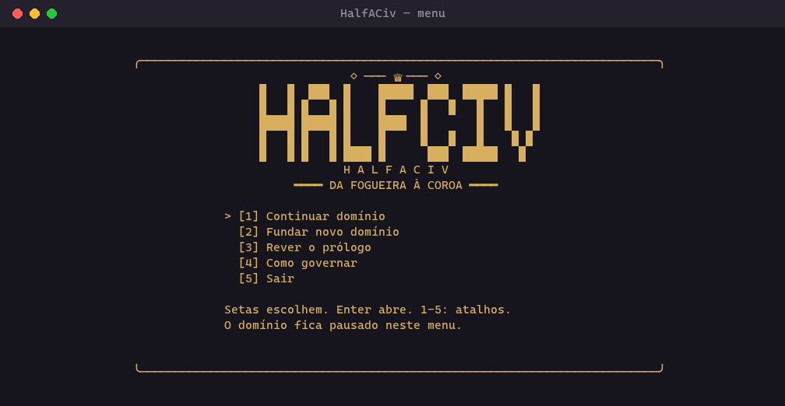
</div>

---

## 📸 Capturas

O jogo tem nove páginas: **Domínio, Obras, Conselho, Decretos, Fé, Crônicas, Recrutas, Personagem e Ajustes**. `Tab` e `Shift+Tab` circulam entre elas, e a simulação continua enquanto você navega.

<div align="center">
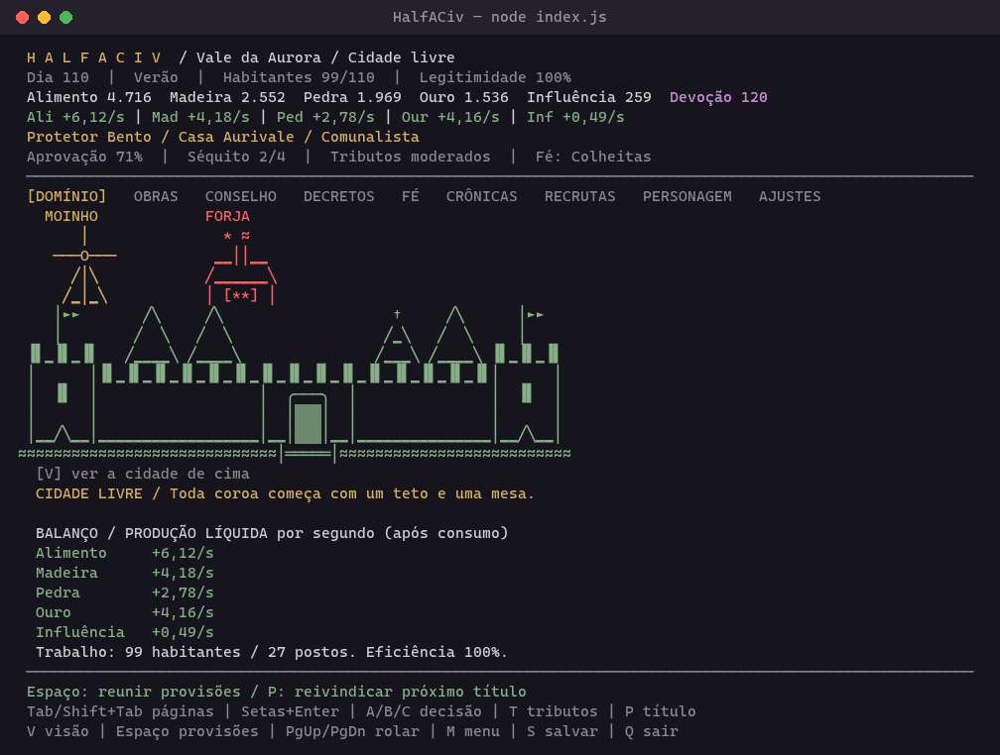
</div>

<table>
  <tr>
    <td width="50%" align="center">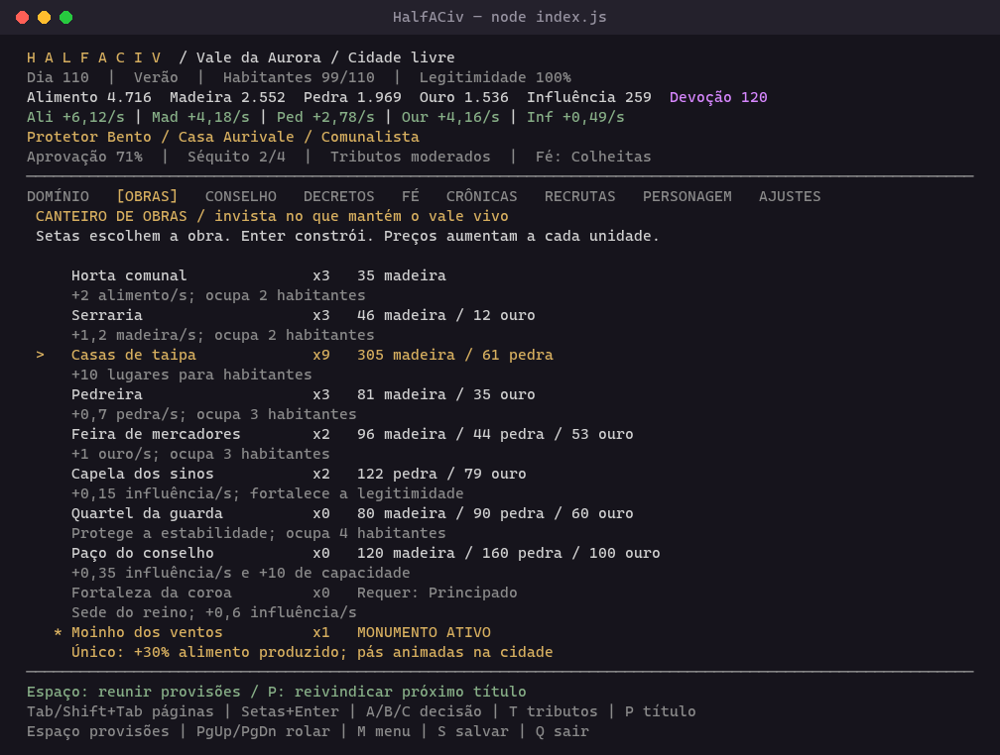<br><b>Obras</b>: preços crescem a cada unidade</td>
    <td width="50%" align="center">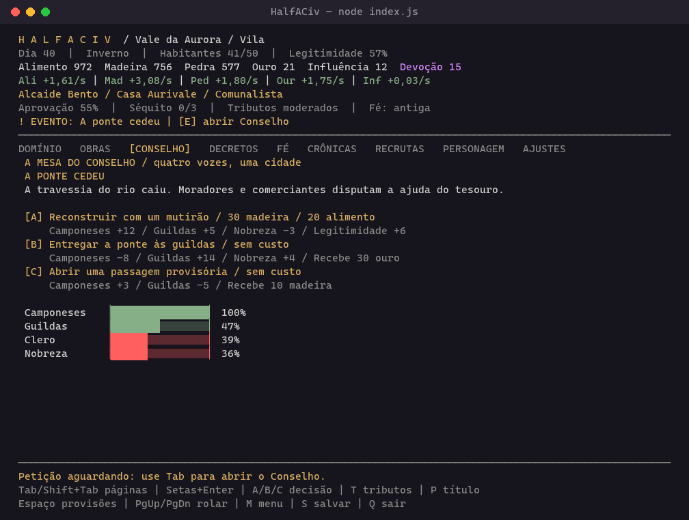<br><b>Conselho</b>: cada resposta mostra seus efeitos</td>
  </tr>
  <tr>
    <td align="center">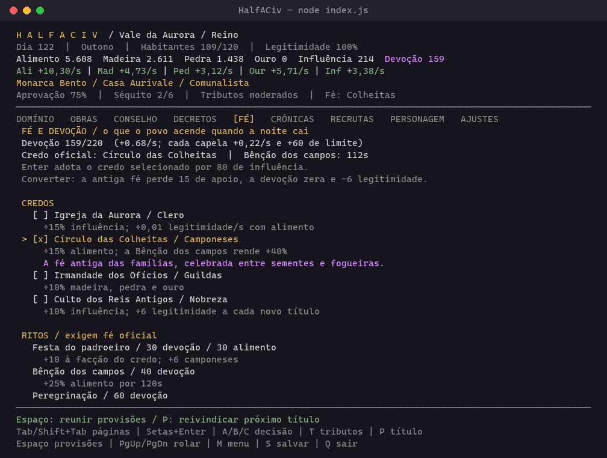<br><b>Fé</b>: credos ligados às facções e ritos</td>
    <td align="center">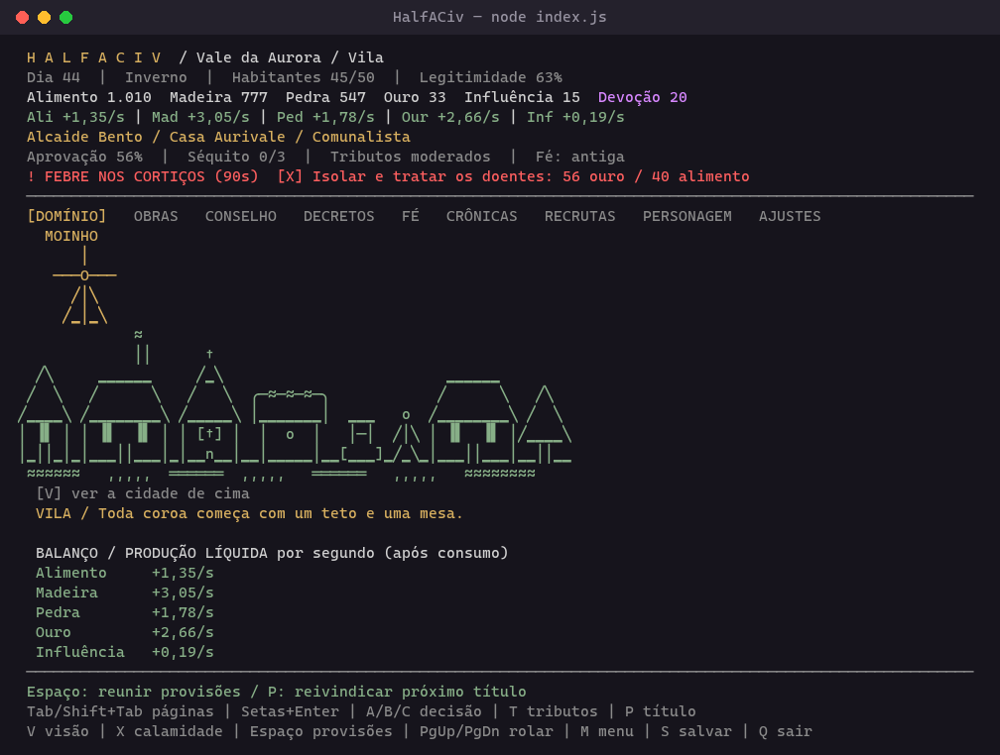<br><b>Calamidade</b>: drena o domínio até você agir com <code>X</code></td>
  </tr>
  <tr>
    <td align="center">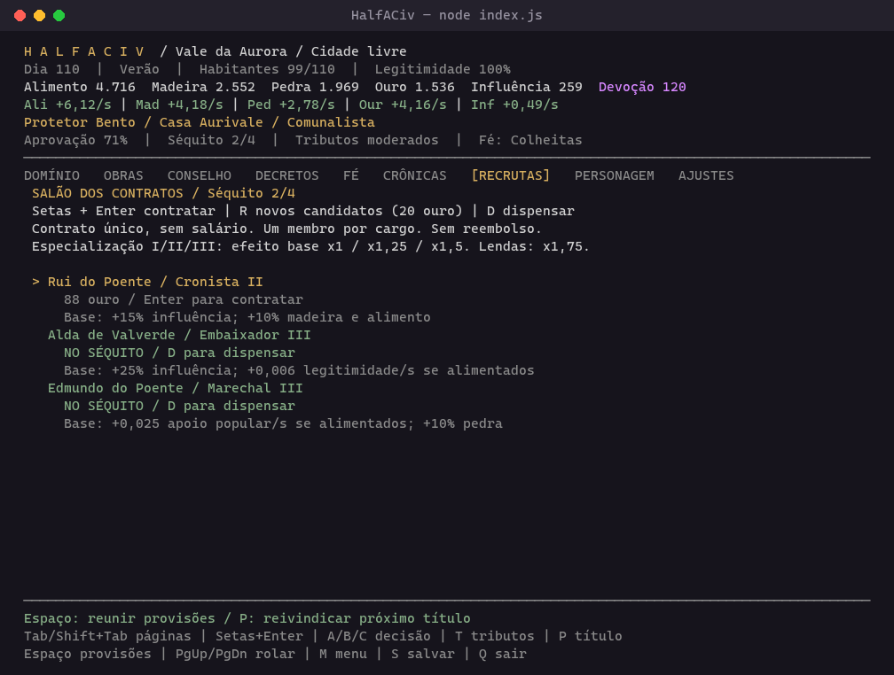<br><b>Recrutas</b>: monte o séquito do governante</td>
    <td align="center">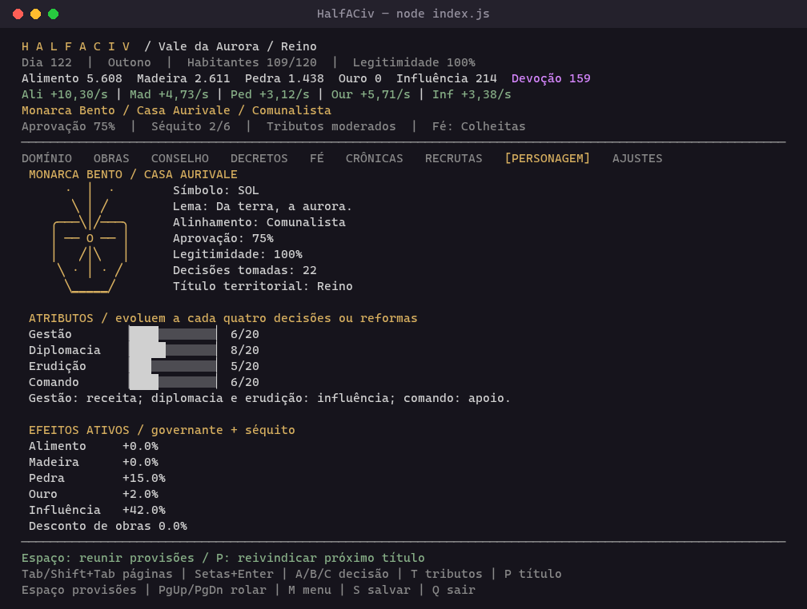<br><b>Personagem</b>: brasão, atributos e bônus em vigor</td>
  </tr>
</table>

<details>
<summary><b>🎞️ Mutirão animado (Espaço)</b></summary>
<br>
<div align="center">
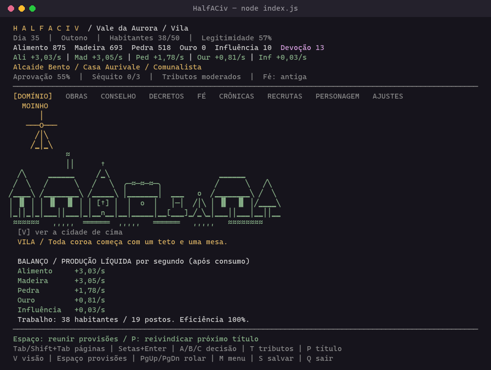
</div>

Ao reunir provisões, um trabalhador transporta a carga numa animação curta, visível em qualquer página, sem interromper a produção nem os comandos.
</details>

> [!NOTE]
> As capturas usam o modo **Unicode** das ilustrações (aba **Ajustes**). O padrão é ASCII, que funciona em qualquer terminal.

---

## 🎮 Controles

| Tecla | Ação |
| --- | --- |
| `Tab` / `Shift+Tab` | Próxima página / página anterior |
| `V`, no Domínio | Alternar panorama e planta da cidade vista de cima |
| `Setas` e `Enter` | Selecionar e construir uma obra ou promulgar uma reforma |
| `A` / `B` / `C` | Escolher uma resposta na página Conselho |
| `T` | Alternar tributos brandos, moderados e severos |
| `P` | Reivindicar o próximo título quando cumprir os requisitos |
| `Espaço` | Mutirão: +2 alimento e +1 madeira, no máximo uma vez por segundo |
| `X` | Responder à calamidade em curso |
| `R`, em Recrutas | Convocar três candidatos novos por 20 ouro |
| `D`, em Recrutas | Dispensar o membro selecionado, sem reembolso |
| `Setas` e `Enter`, em Fé | Adotar um credo ou celebrar um rito |
| `Enter`, em Ajustes | Alternar ilustrações entre ASCII e Unicode |
| `PgUp` / `PgDn` | Rolar o conteúdo em terminais menores |
| `S` | Salvar |
| `M` / `Esc` | Salvar, pausar e abrir o menu |
| `Q` / `Ctrl+C` | Salvar e sair |

### Ilustrações ASCII ou Unicode

A aba **Ajustes** troca o conjunto de caracteres. **ASCII** é o padrão e funciona em qualquer terminal. **Unicode** desenha cenas, mapa, brasões, molduras e barras com linhas, cantos e blocos contínuos, mantendo o mesmo alinhamento; requer um terminal UTF-8, como o Windows Terminal. A escolha vale também para o menu e o prólogo e fica em `saves/settings.json`, separada da campanha.

---

## 🌾 Como o vale cresce

**Primeiros passos:** construa uma segunda horta e uma pedreira em **Obras**. Construa casas para passar de vinte habitantes. Responda às petições no **Conselho**, acumule ouro e reivindique a **Vila** com `P`: isso libera feiras, capelas e as primeiras reformas.

```
Aldeia  ──►  Vila  ──►  Cidade livre  ──►  Principado  ──►  Reino
```

| Sistema | Como funciona |
| --- | --- |
| **Economia** | Hortas alimentam os habitantes; serrarias e pedreiras sustentam obras; feiras e tributos rendem ouro; instituições produzem influência. Trabalhadores insuficientes reduzem a produção, mas não é preciso distribuir habitantes manualmente. |
| **Sobrevivência** | Cada habitante consome alimento. A fome reduz a população, o apoio popular e a legitimidade. A cidade sempre conserva cinco sobreviventes, e o mutirão permite recomeçar. |
| **Estações** | Um dia dura 10 segundos; uma estação, 120 segundos. O inverno reduz a colheita: mantenha reservas ou mais hortas. |
| **Política** | Camponeses, guildas, clero e nobreza têm interesses diferentes. As petições mostram os efeitos de cada resposta antes da escolha. Reformas exigem uma coalizão de três facções e modificam a economia e a legitimidade. |
| **Progressão** | Cada título exige população, obras, reformas, ouro e reconhecimento político. Chegar a Reino conclui o objetivo desta versão, mas a simulação continua. |
| **Feitos** | Dezenove metas permanentes, como fundar o reino, erguer todos os monumentos ou vencer cinco calamidades. Cada feito rende +1% de toda a produção; a lista fica em **Crônicas**. |

<details>
<summary><b>⛪ Fé, credos e ritos</b></summary>
<br>

Capelas geram devoção. A partir da Vila, com uma capela, a aba **Fé** permite declarar um credo oficial, cada um ligado a uma facção:

| Credo | Facção | Efeito |
| --- | --- | --- |
| Igreja da Aurora | Clero | +15% influência; +0,01 legitimidade/s com alimento |
| Círculo das Colheitas | Camponeses | +15% alimento; a Bênção dos campos rende +40% |
| Irmandade dos Ofícios | Guildas | +10% madeira, pedra e ouro |
| Culto dos Reis Antigos | Nobreza | +10% influência; +6 legitimidade a cada título |

A primeira declaração custa 25 de influência. Converter custa 80, zera a devoção, tira 15 de apoio da facção da fé antiga e 6 de legitimidade, e só é possível 240 segundos depois da última.

A devoção paga ritos: **Festa do padroeiro**, **Bênção dos campos** (+25% alimento por 120 s), **Peregrinação** e **Procissão penitente**, que encerra febre ou praga.
</details>

<details>
<summary><b>🔥 Calamidades</b></summary>
<br>

Incêndio, febre, bandidos e praga nas hortas surgem com o jogo aberto, a cada poucos minutos, e drenam recursos, habitantes ou apoio até você responder com `X`.

- Responder custa recursos, que crescem com o título, e rende apoio e legitimidade.
- Ignorada por 90 segundos, a calamidade termina cobrando um preço final.
- O quartel da guarda reduz pela metade o dano dos bandidos.
- Calamidades não ocorrem durante o progresso offline.
</details>

---

## 🏰 Obras especiais e planta da cidade

As quatro obras únicas ficam no final da lista de **Obras**. A cena do Domínio ganha sprites animados conforme você as constrói, com cores próprias sobre o cenário.

| Obra | Disponível em | Efeito |
| --- | --- | --- |
| 🟡 Moinho dos ventos | Aldeia | +30% alimento produzido, antes do consumo |
| 🔴 Forja rubra | Vila | +25% madeira e pedra |
| 🔵 Torre das estrelas | Cidade livre | +40% influência |
| 🟣 Jardim dos juramentos | Cidade livre | +0,025 apoio popular/s e +0,01 legitimidade/s, enquanto houver alimento |

No **Domínio**, `V` alterna entre o panorama e a **planta da cidade**: rio, ponte, estrada, praça e lotes de construção. A cerca vira muralha a partir de Cidade livre. Cada lote representa um tipo de obra, e o número indica quantas unidades você construiu (`++` para 100 ou mais).

<div align="center">
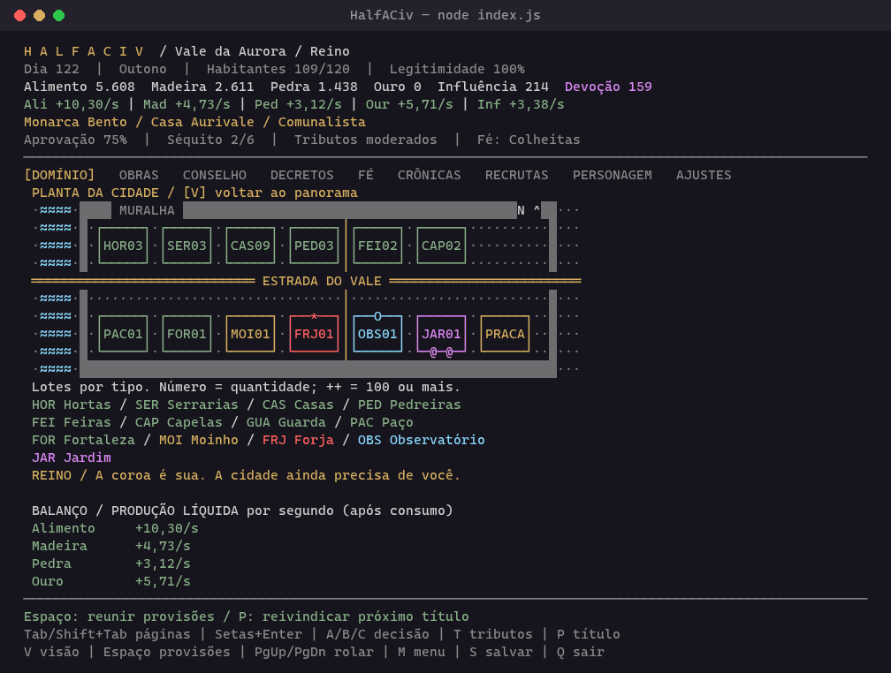
</div>

---

## 🛡️ Recrutas e governante

A aba **Recrutas** mostra candidatos com nome, título profissional, especialização e custo de contrato. O cargo define o efeito durante a campanha, ativo também no progresso offline:

| Cargo | Efeito base |
| --- | --- |
| Intendente | +15% alimento produzido e +8% receita |
| Guardião das matas | +20% madeira e +10% pedra |
| Mestre de obras | -12% custo de construção |
| Embaixador | +25% influência e +0,006 legitimidade/s com alimento |
| Marechal | +0,025 apoio popular/s com alimento e +10% pedra |
| Cronista | +15% influência e +10% madeira e alimento |

- A especialização **I, II ou III** multiplica os efeitos por 1, 1,25 ou 1,5.
- Contratos não cobram salários. Há um personagem por cargo e de dois a seis lugares no séquito, conforme o título.
- Os personagens e o estado do sorteio ficam no save: reabrir não troca a lista.

> [!TIP]
> Raramente, cerca de uma vaga em dez, o salão recebe uma **lenda do vale**, marcada com `* LENDA *`: nome, cargo e frase próprios, especialização III, efeito x1,75 e o dobro do custo. Há 22 delas, e contratar a primeira vale o feito **Lenda à mesa**. Uma não consegue decidir a primeira letra do próprio nome.

<details>
<summary><b>👤 Governante, casas e alinhamento</b></summary>
<br>

O topo da tela mostra nome e casa do governante, alinhamento, aprovação média das quatro facções, séquito e tributos. **Personagem** apresenta o brasão da Casa **Aurivale**, **Corvobravo** ou **Carvalhal**, seu lema, atributos, apoio de cada facção e os bônus em vigor. A casa é sorteada e não concede vantagem econômica.

O governante começa como líder e chega a monarca junto com o reino.

- Decisões pró-camponeses favorecem o alinhamento **comunalista**; privilégios nobres favorecem o **monarquista**. No centro, o governante é **conciliador**.
- Os tributos pesam no alinhamento, mas alterná-los não acumula pontos.
- A cada quatro decisões ou reformas aprovadas, o atributo praticado sobe até 20: **gestão** melhora a receita, **diplomacia** e **erudição** melhoram a influência, e **comando** melhora a recuperação do apoio popular com alimento.
- Reformas dos mosteiros praticam erudição; pactos de vassalagem e decisões de fronteira praticam comando; as outras reformas praticam gestão, e as outras petições, diplomacia.
</details>

---

## 💾 Saves e progresso offline

- **Autosave** a cada 15 segundos e ao sair. Dentro do jogo, `M` ou `Esc` salva e abre o menu, pausando a campanha.
- **Até uma hora de progresso offline**, com produção, consumo, estações e fome. Petições aguardam sua decisão; o intendente não escolhe por você.
- Ao voltar, o **Relatório do intendente** mostra quanto cada recurso, a devoção e a população mudaram, além dos feitos conquistados.
- Save local em `saves/realm.json`. Para outra campanha, aponte `HALFACIV_SAVE` para outro arquivo.
- Saves da versão anterior são migrados ao carregar, preservando nome, recursos, construções, população, tempo e crônicas.

> [!WARNING]
> Faça uma cópia antes de editar o save manualmente e evite abrir duas instâncias no mesmo arquivo. Um save corrompido é preservado e impede a inicialização, em vez de ser substituído por uma campanha vazia.

---

## 🛠️ Desenvolvimento

```sh
npm test                          # testes com node --test
npm run simulate                  # bot joga com as regras reais até o reino
node index.js --preview           # renderiza o Domínio sem terminal interativo
node index.js --preview 2         # renderiza outra página pelo índice
node index.js --preview menu      # menu inicial
node index.js --preview intro     # prólogo
node index.js --preview map       # planta da cidade
node index.js --preview 0 --unicode
```

- `simulate` joga com as mesmas regras, sem recursos extras, para verificar que é possível chegar ao reino.
- `--preview` renderiza uma página sem tocar no save.
- `NO_COLOR=1` desativa as cores.

<details>
<summary><b>📁 Estrutura do projeto</b></summary>
<br>

| Arquivo | Conteúdo |
| --- | --- |
| `index.js` | Loop principal, teclado e prévia |
| `src/game.js` | Recursos, obras, reformas, petições e progressão |
| `src/ui.js` | Renderização das páginas |
| `src/art.js` | Cenas ASCII do panorama e obras especiais |
| `src/map.js` | Planta da cidade vista de cima |
| `src/front.js` | Prólogo, menu e relatório do intendente |
| `src/court.js` | Governante, casas, recrutas e lendas |
| `src/faith.js` | Credos, devoção e ritos |
| `src/calamity.js` | Calamidades |
| `src/feats.js` | Feitos |
| `src/glyphs.js` | Conversão ASCII → Unicode |
| `src/storage.js` | Saves, backups e ajustes |
| `src/interaction.js` | Navegação e mutirão |
| `scripts/simulate.js` | Bot de balanceamento |
| `test/` | Testes |

</details>

### Roadmap

A versão **0.2** entrega uma campanha local com treze construções, cinco reformas, sete petições com três escolhas cada, quatro facções, quatro credos, recrutamento e cinco títulos. Guerras territoriais, relações entre reinos e sucessão dinástica ficam para versões futuras.

---

## 📜 Referência e identidade

Inspirado na ideia de um idle de terminal do [Elden Grid, de localhost-ayu](https://github.com/localhost-ayu/elden-grid). HalfACiv foi implementado do zero: não incorpora código, artes ou interface daquele repositório. As cenas ASCII, a economia de sobrevivência e a progressão política foram criadas para este jogo.

Três ideias de mecânica vieram do Elden Grid e foram reescritas para o tema medieval: crises que ficam ativas até o jogador agir (aqui, **calamidades**), conquistas com bônus permanente de produção (**feitos**) e o resumo do progresso offline (**relatório do intendente**).

<div align="center">
<br>
<sub>Toda coroa começa com um teto e uma mesa.</sub>
</div>
